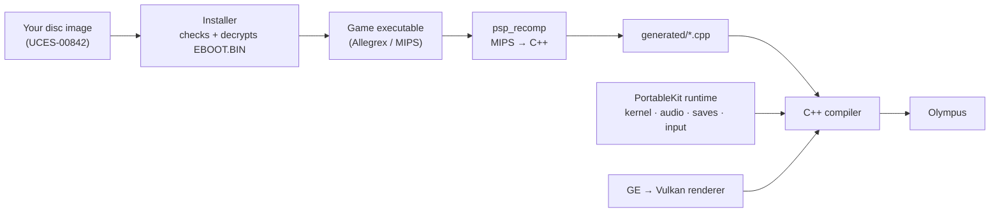

<div align="center">


# Olympus

**God of War: Chains of Olympus (PSP), recompiled to run natively on your computer and phone.**

[](docs/MISSING.md)
[](#macos)
[](#android)
[](LICENSE)

**English** · [Português (Brasil)](README.pt-BR.md)

</div>

---

Olympus is a native port made by **static recompilation**: the game's PSP code is translated ahead of time into C++ and compiled for your machine, then run on a reimplementation of the PSP's system software, drawing through Vulkan. No emulator, no JIT. It is a sibling of [Sparta](https://github.com/arnaldolima1/gow-ghost-of-sparta-pc) (Ghost of Sparta): the same engine, Ready At Dawn's, on the same framework.

> [!WARNING]
> **Alpha.** Only the opening of the game has been played so far. Expect bugs, graphical glitches and crashes.

> [!IMPORTANT]
> **No game data is included.** You need your own copy of the game: the **European release, `UCES-00842`** (1.00), as an uncompressed `.iso` of your own UMD. Nobody here can give you a copy or tell you where to get one. Olympus is not affiliated with Sony Interactive Entertainment, Santa Monica Studio or Ready At Dawn.

## Download and play

Get the latest build from the [**releases page**](https://github.com/arnaldolima1/gow-chains-of-olympus-pc/releases). On every platform the first start asks for your `.iso`, checks it, and from then on goes straight to the game.

### macOS

1. Open `olympus-<version>-macos-arm64.dmg` and drag **Olympus** into Applications.
2. The first time, macOS refuses to open it (it is not notarized): choose **Done**, then **System Settings › Privacy & Security › Open Anyway**. Or run `xattr -dr com.apple.quarantine /Applications/Olympus.app`.
3. Pick your `.iso`.

Needs a Mac with Apple Silicon (M1 or newer).

### Android

1. Install `olympus-<version>-android-arm64.apk` (allow installing apps from your browser or file manager).
2. Pick your `.iso` in the setup. It is copied into the app: about 2 GB free.

Needs a 64-bit phone or tablet with Android 10 or newer and Vulkan. Touch controls appear when you touch the screen; a gamepad works too, and Back opens the menu. Later versions install over this one and keep your saves.

### Windows

Not released yet: [docs/WINDOWS.md](docs/WINDOWS.md) has the steps to build it.

## Controls

| PSP | Keyboard and mouse |
| --- | --- |
| Analog stick | <kbd>W</kbd> <kbd>A</kbd> <kbd>S</kbd> <kbd>D</kbd> |
| D-pad | Arrow keys |
| × (jump, confirm) | <kbd>Space</kbd> |
| □ (light attack) | <kbd>E</kbd> |
| △ (heavy attack) | Left mouse button |
| ○ (grab) | Right mouse button or <kbd>F</kbd> |
| L / R | <kbd>Q</kbd> / <kbd>Left Shift</kbd> |
| START / SELECT | <kbd>Enter</kbd> / <kbd>Backspace</kbd> |

PlayStation and Xbox gamepads work too. <kbd>Esc</kbd> (or L3+R3) opens the menu, where every key can be changed. START skips the pre-rendered movies. The interface is in English or Brazilian Portuguese (System › Language).

## Status

The title menu and the opening of the game play at **60 fps and full speed**:

| Platform | Tested on |
| --- | --- |
| **macOS** | macOS 26, Apple M4 |
| **Android** | Moto g84 (Snapdragon 695): most of it at full speed, the heaviest fights at 96–98% |
| **Windows** | not tried yet ([docs/WINDOWS.md](docs/WINDOWS.md)) |
| **Linux** | not tried yet |

What is known to be missing: [docs/MISSING.md](docs/MISSING.md). Performance work: [docs/PERFORMANCE.md](docs/PERFORMANCE.md).

## What's new

- **0.1.0 — Recompiled and on Android.** The first release, for macOS and Android: the game's code recompiled (193 units), 60 fps on an Apple M4; START skips the movies; faster display lists on phones.

Older versions: see the [releases page](https://github.com/arnaldolima1/gow-chains-of-olympus-pc/releases).

## How it works



1. **The installer** reads your disc image, checks that it is the supported release, and decrypts the game's executable.
2. **The recompiler** turns every function of the game's MIPS code into C++.
3. **The compiler** builds that C++ together with [PortableKit](https://github.com/TeamGDB/PortableKit)'s runtime: the PSP's kernel and system modules, audio, movies, saves, input, and a renderer that translates the PSP's graphics commands to Vulkan.

The framework changes this port needed live on the `sparta` branch of [a fork of PortableKit](https://github.com/arnaldolima1/PortableKit/tree/sparta), shared with Sparta, this repository's submodule.

## Building from source

Start with `git clone --recursive https://github.com/arnaldolima1/gow-chains-of-olympus-pc.git`. Every build has the same steps: build the program, install the game from your `.iso`, recompile the game's code (`generated/`), and build again with it.

- **macOS** (Apple Silicon, Xcode command line tools):

  ```bash
  brew install cmake ninja ccache python sdl3 molten-vk vulkan-loader vulkan-headers glslang ffmpeg
  scripts/build.sh                                              # the program, without the game's code
  build/dev/bin/OlympusNative --install /path/to/UCES00842.iso --in-place
  scripts/generate.sh                                           # recompile the game's code to C++
  scripts/build.sh                                              # compile it
  scripts/run.sh                                                # play
  ```

- **Android:** after the macOS steps, with the Android SDK, NDK and a JDK: `scripts/build_android.sh`, then `scripts/run_android.sh` to install it on a phone connected by USB.
- **Windows:** [docs/WINDOWS.md](docs/WINDOWS.md) (Visual Studio 2022 with clang-cl, Ninja, the Vulkan SDK and SDL3; not tried yet).

Without the recompiled code the program still runs the game, under PortableKit's interpreter, about twenty times slower: that is how a new game is brought up.

<details>
<summary><b>Making a release</b></summary>

| Platform | Build | Publish |
| --- | --- | --- |
| macOS + Android | `scripts/release_macos.sh`, `scripts/release_android.sh` | `scripts/publish_release.sh` |
| Windows | `scripts\release_windows.ps1` | `scripts\publish_release_windows.ps1` |

The version comes from `VERSION`. When that version is already published, the release script raises its last number first and commits the change.

</details>

<details>
<summary><b>Repository layout</b></summary>

```text
.
├── CMakeLists.txt     # adds PortableKit and declares the OlympusNative target
├── VERSION            # the version the next release gets
├── host/              # the game's profile (olympus_profile.cpp)
├── scripts/           # build, generate, run and release scripts (.sh; .ps1 for Windows)
├── tools/             # development helpers
├── packaging/         # icon, read-mes for each release, third-party notices
├── docs/              # MISSING.md, PERFORMANCE.md, WINDOWS.md
├── portablekit/       # submodule: the recompiler and runtime (fork, branch sparta)
│
│   # created locally, never committed:
├── generated/         # the recompiled game code
├── build/             # builds and logs
└── release/           # finished releases
```

</details>

<details>
<summary><b>Useful switches</b> (environment variables)</summary>

| Variable | What it does |
| --- | --- |
| `OLYMPUS_PERF=log` | One line a second: frame rate, speed, where the frame time went |
| `OLYMPUS_TRACE_STALLS=1` | Every frame longer than 40 ms, and what it waited on |
| `OLYMPUS_HALF_RATE=1` | *Limit to 30 fps*, for this run |
| `OLYMPUS_TEXTURE_PACK=/path/to/pack` | Use the texture pack in that folder, without installing it |
| `OLYMPUS_FLIP_UNLIMITED=1` | Turn the one-flip-a-vblank cap off, to compare |
| `OLYMPUS_NO_MOVIE_SKIP=1` | START does not skip movies |

PortableKit's [docs/BRINGING_UP_A_GAME.md](https://github.com/TeamGDB/PortableKit/blob/main/docs/BRINGING_UP_A_GAME.md) has the rest.

</details>

## Contributing

See [CONTRIBUTING.md](CONTRIBUTING.md). In short: English only, no game data of any kind, and a change that is true of the PSP rather than of this game belongs in PortableKit.

## Credits

- [TeamGDB](https://github.com/TeamGDB) for PortableKit, the recompiler and runtime this port stands on, and for [Purun](https://github.com/TeamGDB/Purun), whose executable uses the same tag: its published key table is the one this port carries.
- The PSP scene's public documentation of the console, among it [psdevwiki](https://www.psdevwiki.com/psp/).
- [PPSSPP](https://www.ppsspp.org/), used as a reference for how the game behaves; no code from it is included.

## License

The code in this repository is MIT licensed ([LICENSE](LICENSE)). PortableKit and its third-party components keep their own licenses ([packaging/THIRD_PARTY_NOTICES.md](packaging/THIRD_PARTY_NOTICES.md)). *God of War* is a trademark of Sony Interactive Entertainment; the game itself is not covered by this license and is not included.
