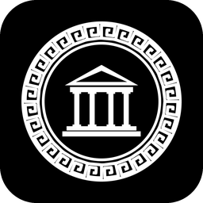

<div align="center">



# Olympus

**God of War: Chains of Olympus (PSP), recompiled to run natively on your computer and phone.**

[](docs/MISSING.md)
[](#building-from-source)
[](#building-from-source)
[](LICENSE)

**English** · [Português (Brasil)](README.pt-BR.md)

</div>

---

Olympus is a sibling of [Sparta](https://github.com/arnaldolima1/gow-ghost-of-sparta-pc) (Ghost of Sparta): the same engine, Ready At Dawn's, on the same framework, [PortableKit](https://github.com/arnaldolima1/PortableKit) (the `sparta` branch of the fork). The game's code is recompiled ahead of time to C++, and the PSP around it (system, graphics on Vulkan, sound, input, saves) is PortableKit's.

> [!IMPORTANT]
> This repository contains no game data. You need your own copy of the game: the European release, **UCES-00842** (1.00). The program installs it from your disc image.

## Status

**Early.** No release yet. On a Mac, under the interpreter (before the game's code is recompiled), the game boots through the logos to the title menu at 60 frames a second and full speed. See [what is missing](docs/MISSING.md).

## Building from source

Start with `git clone --recursive https://github.com/arnaldolima1/gow-chains-of-olympus-pc.git`. Every build has the same steps: build the program, install the game from your `.iso`, recompile the game's code (`generated/`), and build again with it.

- **macOS** (Apple Silicon, Xcode command line tools):

  ```bash
  brew install cmake ninja ccache python sdl3 molten-vk vulkan-loader vulkan-headers glslang ffmpeg
  scripts/build.sh                                              # the program, without the game's code
  build/dev/bin/OlympusNative --install /path/to/UCES00842.iso --in-place
  scripts/generate.sh                                           # recompile the game's code to C++
  scripts/build.sh                                              # compile it
  scripts/run.sh                                                # play
  ```

- **Android:** after the macOS steps, with the Android SDK, NDK and a JDK: `scripts/build_android.sh`, then `scripts/run_android.sh` to install it on a phone connected by USB.
- **Windows:** [docs/WINDOWS.md](docs/WINDOWS.md) (not tried yet).

Without the recompiled code the program still runs the game, under PortableKit's interpreter, about twenty times slower: that is how a new game is brought up.

## Credits

- [PortableKit](https://github.com/TeamGDB/PortableKit) by TeamGDB: the recompiler and the PSP system around the game.
- The executable's key table is the published one for its tag, as [Purun](https://github.com/TeamGDB/Purun) carries it.
- God of War is a trademark of Sony Interactive Entertainment. This is an unofficial project, not affiliated with Sony or Ready At Dawn.

## License

MIT: see [LICENSE](LICENSE). It covers this repository's code only, not the game.
